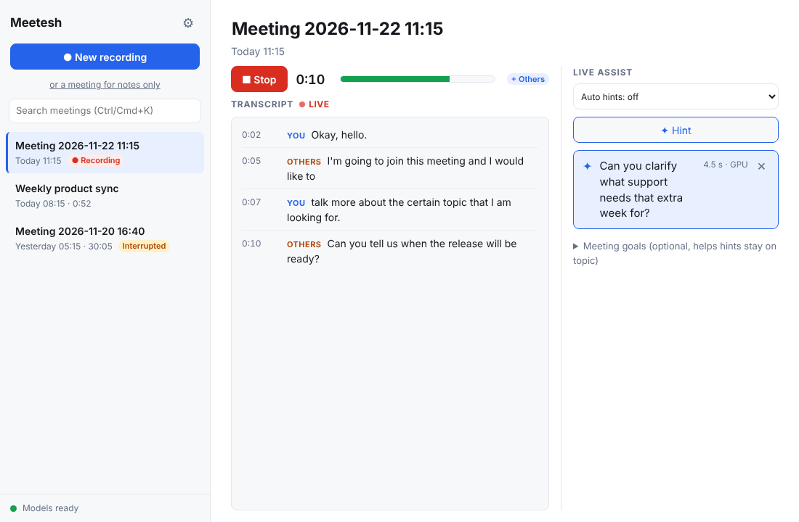
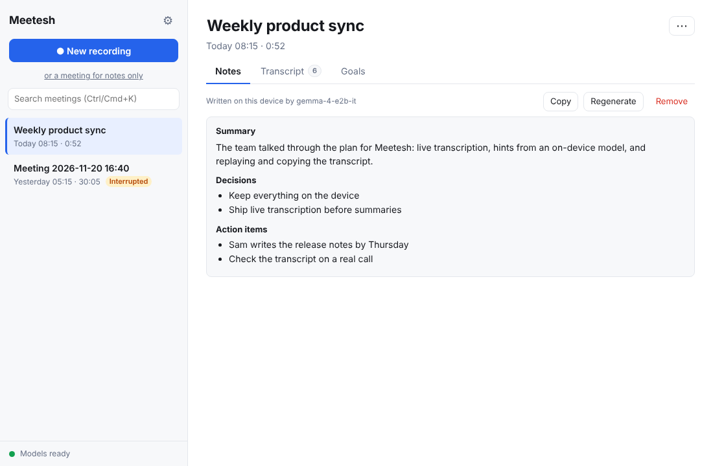
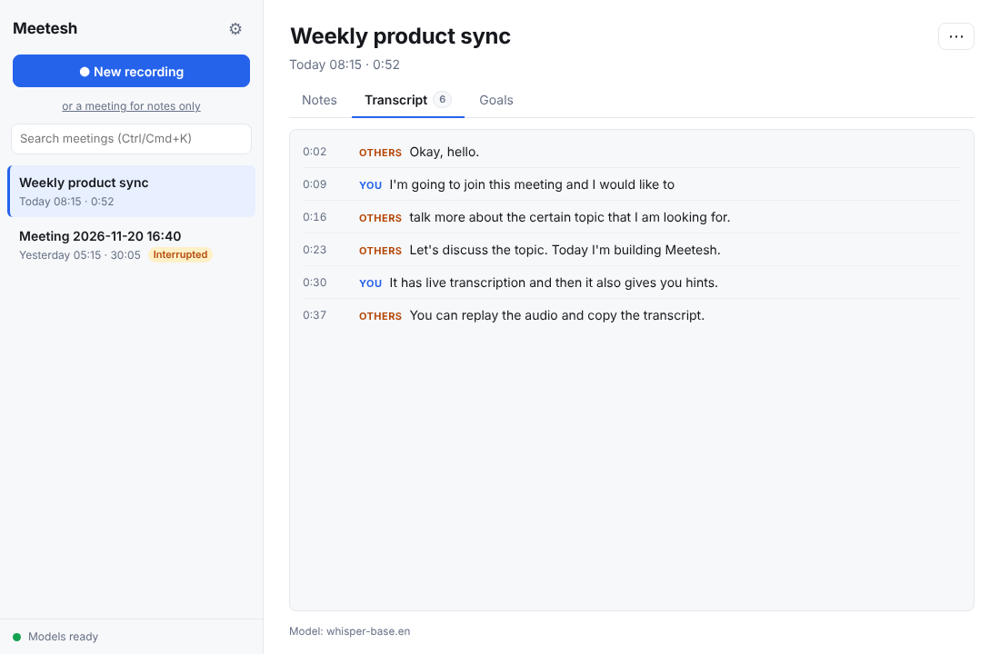
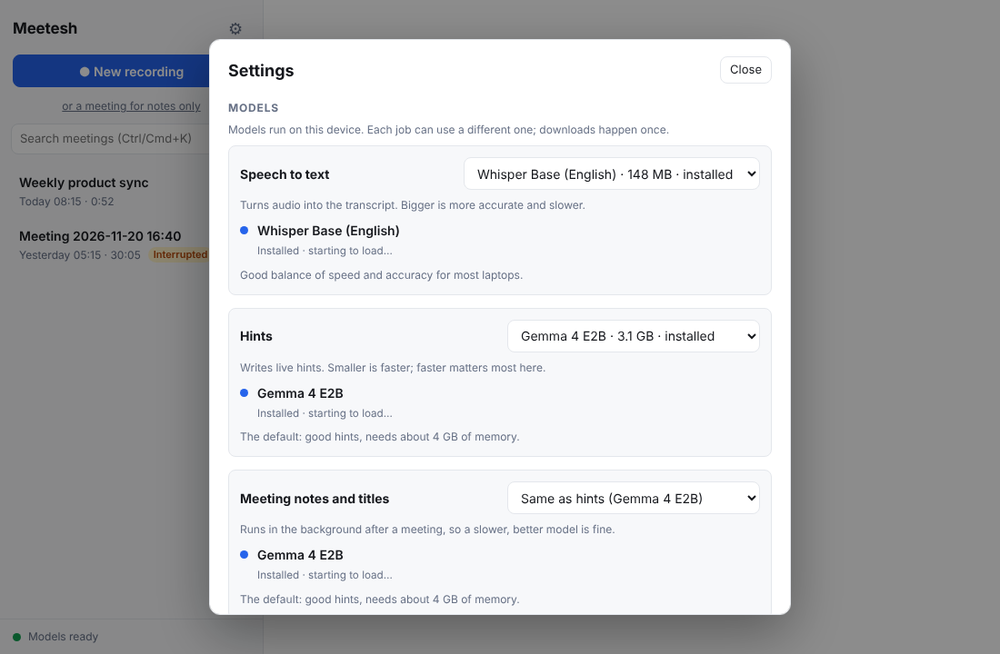
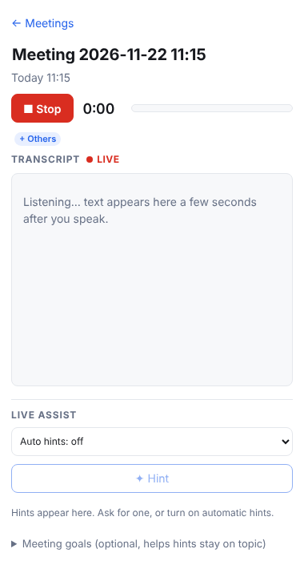

# Meetesh

**A private, local-first AI meeting assistant.** Record a meeting, get a live transcript, and ask for a quiet hint during the conversation. All on your own machine, with no account and no cloud.

[](https://github.com/nareshipme/Meetesh/actions/workflows/ci.yml)
[](LICENSE)

> **Status: early, pre-alpha.** Recording, live transcription and live assist work. The app has been opened and used by hand on macOS and Windows, and the maintainer found the generated hints good enough for a first version. CI builds and tests it on Linux, macOS and Windows. Expect rough edges (see [Known issues](#known-issues-and-planned-work)). Contributions and bug reports are very welcome.

The name comes from *ishara* (इशारा), Hindi/Urdu for a quiet hint or signal, like a glance across the table.

## Why Meetesh

- **Private by design.** Audio and transcripts stay on your device. After the one-time model download, the app works fully offline. Nothing is uploaded.
- **Local models.** Speech recognition ([whisper.cpp](https://github.com/ggml-org/whisper.cpp)) and live hints ([llama.cpp](https://github.com/ggml-org/llama.cpp) with Gemma 4 E2B) run on-device. No API keys needed.
- **Light and native.** Built with [Tauri](https://tauri.app) and Rust, not Electron.
- **Swappable models.** Models are listed in a manifest, not hard-coded, so improving or replacing one is a data change.
- **Open source (MIT).** Read it, fork it, improve it.

## Screenshots

These show the interface running against the built-in sample-data backend (see [CONTRIBUTING.md](CONTRIBUTING.md)), so the transcript text is sample text, not a real recording.


*While recording: the transcript on the left (You and Others), live assist on the right with the hint button, automatic hints and the current hint.*


*After the meeting: tabs for Notes, Transcript and Goals; rarer actions are in the ⋯ menu.*


*The transcript of a call: your microphone and the other participants' audio, labelled You and Others.*


*Settings: one model choice for each job (speech, hints, notes), with downloads in the same place.*



*A narrow window: the assist area moves under the transcript.*

## What works today

| Feature | State |
|---|---|
| Record from the microphone, saved as crash-safe segments (about 1 s of audio at risk after a crash) | Working |
| Recover interrupted recordings on next launch | Working |
| Local transcription of a finished recording (Whisper) with timestamps | Working |
| Live transcription while recording (text a few seconds behind speech) | Working |
| Quiet or distant voices are no longer ignored: speech detection follows the room's noise level instead of a fixed volume, and each chunk is volume-normalized before Whisper hears it (on synthetic speech from a faint microphone: 62 of 62 words lost before, 0 lost now) | Working on synthetic speech; needs confirming on real recordings ([#4](https://github.com/nareshipme/Meetesh/issues/4)) |
| Model downloads you can pause, resume, retry or discard, with progress and a SHA-256 check (hashed while downloading, so there is no wait at 100%) | Working |
| Models load in the background at startup, with a progress bar (real percentage for the live-assist model) and a warm-up, so the first hint is not slow | Working |
| Live assist: ask for a short hint from the last few minutes (button or Ctrl/Cmd+Shift+H), written by an on-device model (Gemma 4 E2B), streamed into the window and labelled GPU or CPU | Working (manual trigger) |
| If the GPU cannot run the model, hints automatically fall back to the CPU, the sidebar says "CPU (GPU failed)", and llama.cpp's own error goes to the log | Working (a GPU failure is simulated in tests) |
| GPU for live assist: Metal on macOS, opt-in Vulkan on Windows and Linux (see [GPU acceleration](#gpu-acceleration)) | Metal compiles in CI but is failing on at least one Mac ([#3](https://github.com/nareshipme/Meetesh/issues/3)); Vulkan verified with a software Vulkan device only |
| `gpu_probe` tool that tries the known GPU workarounds and reports which one works | Working (Linux verified) |
| Hints never slow down live transcription: while the transcriber has work pending, hint generation pauses (in small steps, bounded so a hint is never starved). Measured with both real models on a 4-core CPU: live text arrived over 30 s late on average (up to 50 s) while hints ran before, and 2.6 s late now, about the same as with no hints (2.3 s) | Working |
| **Automatic hints (opt-in)**: the "Auto hints" menu above the transcript (off by default, remembered). *On questions*: when the other participants ask something (needs system audio, which is what tells their voice from yours) and you have not started answering within 1.5 s. *Questions and pauses*: also after 12 s of quiet following a stretch of talk (at least 30 words), which works with a microphone alone. At most one automatic hint per 45 s; a hint that finds nothing useful stays silent, and it is labelled "after a question" or "during a pause" | Rules unit-tested, wiring only exercised against the mock backend; **not yet tried on a real call** |
| Optional meeting goals that keep hints on topic | Working |
| One-click recording: **New recording** (Ctrl/Cmd+N) opens the consent notice straight away, so starting is one click plus Enter. The consent reminder is still shown before every recording. The microphone is chosen in the same step and remembered | Working |
| **System audio: the other participants.** Tick "Also record the other participants" in the consent step and what the computer plays (a call in Zoom, Meet, Teams, a browser) is recorded as a second track, transcribed live next to your microphone, and shown as **You** / **Others**. Hints see who said what. Windows: WASAPI loopback of the default speakers. macOS 13+: ScreenCaptureKit (asks for the Screen & System Audio Recording permission). Linux: not yet. If the second track cannot start, the microphone recording carries on and you are told | Implemented and compiled for Windows and macOS in this environment, tested with synthetic audio; **not yet run on real Windows or macOS hardware** (see [TESTING.md](TESTING.md#system-audio-the-other-participants)) |
| **Meeting notes**: after a recording stops (or on demand with **✦ Write meeting notes** / **Regenerate**) the on-device model writes a short summary, decisions and action items, saved with the meeting, copyable, with a progress bar and Cancel. Long meetings are summarized in steps (transcript parts become notes, notes become the summary) so they fit the model's 4k context. Starting a new recording cancels a running summary so it never competes with live transcription | Working. Real Gemma 4 E2B on a 4-core CPU, scripted call: 11 lines took 29 s; 176 lines (about 26 minutes of speech, 4 steps) took 222 s, and the notes were faithful. Quality checked on scripted dialogue only, not yet on a real meeting |
| **Readable default titles**: a new meeting is called "Meeting on Sun 22 Nov, 3:45 PM" (the year only when it is not this year) instead of "Meeting 2026-11-22 15:45"; untouched old ones are renamed on upgrade, titles you chose never are | Working |
| **Automatic titles** ([#7](https://github.com/nareshipme/Meetesh/issues/7)): once the notes are written, a meeting that still has the date placeholder ("Meeting on Sun 22 Nov, 3:45 PM") gets a short title from the model, e.g. "Onboarding flow launch date decision" (about 6 s on a 4-core CPU). A title you typed is never replaced, whether you typed it before or after (it is tracked per meeting, and existing custom titles were marked as yours when you upgrade) | Working |
| **Search** across everything: titles, notes and transcript lines, as you type (Ctrl/Cmd+K), with the matched words highlighted and up to three places per meeting (a transcript hit shows its timestamp). Every word must appear, each as a prefix ("quarter road" finds "quarterly roadmap"); case and accents are ignored. Built on SQLite FTS5, so it stays on the device; on a synthetic archive of 500 meetings and 200,000 transcript lines, building the index took 0.3 s (once, on upgrade), a search of two common words 80 ms, and saving a live line with the index kept up to date 0.9 ms. Live text is searchable as it arrives | Working |
| **Markdown export**: **Copy Markdown** or **Export Markdown** (a `.md` file in the app's `exports` folder) with title, date, duration, goals, notes and the transcript (You / Others when both sides were recorded) | Working |
| Meetings list, rename, delete (audio is deleted with the meeting), WAV export | Working |
| **A calmer layout**: while recording, a *live screen* (transcript on the left; on the right the hint button, the automatic-hints menu, the current hint and the meeting goals). After recording, a *review page* with tabs **Notes / Transcript / Goals**, and a **⋯** menu for the rarer actions (copy or export Markdown, export audio, re-transcribe, delete). Everything you set up once is in one **Settings** dialog (gear, or Ctrl/Cmd+,). The sidebar is only meetings, search and a one-line model status | Working in the mock-backend UI checks; not yet used on real hardware |
| **Choose the model for each job** (closes [#8](https://github.com/nareshipme/Meetesh/issues/8)): speech to text (Whisper Tiny, Base, Small compact), hints (Gemma 3 1B, Gemma 4 E2B, Gemma 3 4B) and meeting notes and titles (same as hints, or another model, e.g. a bigger one since it runs in the background). Choices are remembered; a model that is not installed shows its download in the same box; a model nobody uses any more is released from memory | Selection logic unit-tested; see "Model choices" below for what was measured |
| Responsive, dark-mode-aware UI | Working |

What a person has actually tried on real hardware, and what only has automated checks, is tracked in [docs/VERIFICATION.md](docs/VERIFICATION.md).

## Roadmap

| | Planned |
|---|---|
| Next | A global hotkey and a hint overlay that floats over other apps (so a hint is visible while another app is in front) |
| Then | Choosing where an export is saved (a file dialog), exporting several meetings, a Claude-with-your-own-key option for summaries (an idea, not a plan) |
| Then | System audio on Linux (PipeWire/PulseAudio monitor), and capturing one app or window instead of everything |
| Then | Settings and onboarding, signed installers and auto-update |
| Later | Mobile companion app, speaker labels, audio-file import |

## Known issues and planned work

Tracked as GitHub issues:

| Issue | Kind |
|---|---|
| [#3 GPU is not used for model inference](https://github.com/nareshipme/Meetesh/issues/3) (diagnostics, log capture and opt-in Vulkan added; the Mac cause still needs a `gpu_probe` run) | Bug |
| [#4 Missing words in the live transcript: improve audio before transcription](https://github.com/nareshipme/Meetesh/issues/4) (quiet-microphone loss fixed in tests; real-speech confirmation and a larger model option still open) | Improvement |

## Limitations

- Automatic hints only show inside the Meetesh window for now (no overlay or notification over other apps yet). A question is recognised from its wording ("?" or an opening like "Can you…"), so a rhetorical question counts and a question Whisper did not punctuate may be missed. With a microphone alone, questions cannot be told from your own speech, so only the pause trigger applies.
- The live-assist model is a 3.1 GB download and, once downloaded, is loaded into memory at every start (about 4 GB). A per-user switch to load it only on demand is planned.
- Models may run on the CPU even when a GPU is present ([#3](https://github.com/nareshipme/Meetesh/issues/3)). Speech recognition (Whisper) always runs on the CPU. On a CPU-only 4-core Linux machine a hint takes about 6 s.
- Meeting notes need the live-assist model (the same 3.1 GB download). On a CPU-only 4-core machine each step of about 2,000 tokens of transcript took 20 to 85 s in our runs, so a one-hour meeting can take around ten minutes (it runs in the background and can be cancelled; a GPU is much faster). Notes can mishear or omit things, like the transcript they come from.
- A hint can take longer to appear while people are talking, because it yields the processor to live transcription (a few seconds longer on a CPU-only machine; the transcript is never held up).
- Some words can still be missing or wrong in the live transcript ([#4](https://github.com/nareshipme/Meetesh/issues/4)). Faint voices used to be dropped entirely; that is fixed on synthetic test speech but not yet confirmed on real recordings. The default speech model (Whisper base) also simply mishears words, more so with accents and noise; a larger model is not offered yet.
- The other side of a call is captured as one "Others" track: everything the computer plays, so music or notification sounds are included, and several remote speakers are not told apart. Use headphones: with speakers, your microphone also hears the call and the same words appear under both You and Others. Linux has no system-audio capture yet. Not yet verified on real Windows or macOS hardware.
- Packaged macOS builds require macOS 13 or newer (ScreenCaptureKit audio).
- English-only speech models are in the manifest for now.
- One recording per meeting.
- Whisper can mishear words, especially with noise or accents. The transcript is editable data, not ground truth.

## Troubleshooting

**The live-assist row says "CPU" or "CPU (GPU failed)", or a hint failed with "llama decode failed".** The GPU could not run the model (seen with Metal on macOS). Meetesh falls back to the CPU automatically, and llama.cpp's own error message is written to the log file, so nothing is lost. To find out which GPU setting works on your machine, run the probe. It tries the known workarounds, each in a fresh process, and prints which one works and the real error from the ones that fail:

```bash
cargo run -p meetesh-core --example gpu_probe --features metal      # macOS
cargo run -p meetesh-core --example gpu_probe --features vulkan     # Windows / Linux (needs the Vulkan SDK)
```
It looks for the model in the app's models folder; or pass the path as the last argument. Paste the whole output into [#3](https://github.com/nareshipme/Meetesh/issues/3), together with your Mac model, chip, macOS version and memory.

Other switches: `MEETESH_GPU=off` forces the CPU, and `MEETESH_LLAMA_LOGS=1` also writes llama.cpp's routine messages to the log (very chatty).

**Where is the log file?** In the app's log folder, usually `~/Library/Logs/app.meetesh.desktop/` on macOS, `%LOCALAPPDATA%\app.meetesh.desktop\logs` on Windows and `~/.local/share/app.meetesh.desktop/logs` on Linux. The sidebar shows the exact folder when the GPU failed. Logs never contain transcript or audio content.

**A model download is stuck or failed.** Use Pause, Resume, Retry or Discard in the model panel. A paused or failed download keeps what it already has, so Resume continues from there.

**A model fails to load ("Could not load").** Press Retry in the model panel. If it keeps failing, there may not be enough free memory (the assist model needs about 4 GB).

**Where is my data?** The database, recordings and models live in the app data folder (see [TESTING.md](TESTING.md)). Deleting a meeting deletes its audio.

## Quick start

You need Rust, Node 20+, a C/C++ toolchain with `cmake` and clang (Whisper compiles from source on the first build), and the [Tauri prerequisites](https://tauri.app/start/prerequisites/) for your OS.

```bash
git clone https://github.com/nareshipme/Meetesh.git
cd Meetesh
npm install
npm run tauri dev
```

The first build takes several minutes: Whisper and llama.cpp compile from source, and dependencies are built optimized even in dev builds (so hashing a 3 GB model is fast). Then in the app:
1. Open **Settings** (the gear, or Ctrl/Cmd+,) and download the speech model (Whisper Base, about 148 MB, once). The optional live-assist model (Gemma 4 E2B) is 3.1 GB; a smaller, faster one (Gemma 3 1B, 0.8 GB) is also offered. Downloaded models load in the background at every start; the bar at the top shows progress.
2. Click **● New recording** (or press Ctrl/Cmd+N) and confirm the consent notice. Your OS may ask for microphone permission.
3. Talk. Live text appears as you speak. Click **Stop** when done.

See [TESTING.md](TESTING.md) for a full manual test checklist.

## GPU acceleration

Only the live-assist model (llama.cpp) can use the GPU. Speech recognition runs on the CPU on every platform.

| Platform | How |
|---|---|
| macOS | Metal is compiled in automatically. If it fails on your Mac the app falls back to the CPU (see Troubleshooting). |
| Windows, Linux | **Opt-in** Vulkan (a normal build has no GPU support at all, and the sidebar then says "CPU (no GPU support in this build)") (works with NVIDIA, AMD and Intel GPUs). Install the Vulkan SDK first (Windows: LunarG SDK; Ubuntu: `sudo apt install libvulkan-dev glslc spirv-headers`), then run `npm run tauri:gpu` (the same as `npm run tauri dev -- --features vulkan`). |

On Windows, building with Vulkan puts llama.cpp's shader generator in a very deep folder. If the build fails with `CMake error : Not a file: ...cmake_install.cmake` (and "cannot find the batch label specified"), the path is over Windows' 260-character limit: build with a short target folder (`set CARGO_TARGET_DIR=C:\t` before `npm run tauri:gpu`) or turn on Windows long paths. CI reproduced this and the SDK itself installs and is found fine.

The Vulkan build has been verified to compile, load the model onto a Vulkan device and generate with it on Linux using a software Vulkan driver (so the speed on a real GPU is not yet measured). CUDA is not wired up yet.

## Model choices

Each job picks its own model in **Settings**. What we measured on a 4-core CPU with no GPU (Linux sandbox), so you can choose, and so you can compare with your own machine:

**Speech to text.** Mean word error rate over seven synthetic scenarios (clean, quiet, noisy, rushed, trailing off, hum, far microphone; machine-made speech, so absolute numbers are pessimistic and only the comparison matters). Lower is better; "live" is the path used while recording, "whole" is a pass over the finished recording.

| Model | Download | Live | Whole | Time for the bench |
|---|---|---|---|---|
| Whisper Tiny (English) | 78 MB | 23.0% | 21.2% | 175 s (includes a first compile) |
| Whisper Base (English), the default | 148 MB | 18.4% | 14.1% | 288 s |
| Whisper Base, 5-bit | 60 MB | 21.0% | 15.4% | 261 s (not offered: smaller but not faster) |
| Whisper Small (English, compact) | 190 MB | 15.4% | 10.4% | 854 s (measured while other work ran, so roughly 2.5 to 3 times Base) |

**Language models** (same scripted 11-line call and 176-line meeting for all):

| Model | Download | Memory | A hint | Notes, short call | Notes, 26 min | Title |
|---|---|---|---|---|---|---|
| Gemma 3 1B | 0.8 GB | 0.9 GB | 4.1 to 4.6 s | 19 s | 145 s | 3.5 s |
| Gemma 4 E2B, the default | 3.1 GB | about 4 GB | about 6 s | 29 s | 222 s | 6.4 s |
| Gemma 3 4B | 2.5 GB | 3.9 GB | 12.7 to 13.1 s | 46 s | 354 s | 9.7 s |

What the notes looked like: Gemma 4 E2B was faithful to the script; Gemma 3 1B was faster but repeated bullets and put action items under decisions; Gemma 3 4B was well structured but not clearly better than E2B on this script, and slower, so it is offered as an alternative, not as an upgrade. These are single scripted dialogues, not real meetings: treat the quality notes as a first impression. A GPU changes all the speeds.

## How it works

```
mic (cpal) ─> resample to 16 kHz mono ─┬─> segmented WAV on disk   (crash-safe)
                                       ├─> level meter
                                       └─> VAD chunker ─> bounded queue ─> Whisper worker ─> transcript (SQLite) ─> UI

system audio (WASAPI loopback / ScreenCaptureKit) ─> same pipeline, own folder (recordings/<id>/system) and own
                                       VAD chunker, tagged "Others"; padded with silence so both tracks share one clock
```

- The audio callback never blocks. Slow transcription drops live chunks (counted) instead of slowing capture, and a full pass over the saved audio fills any gaps after you stop.
- Everything that does not depend on the operating system lives in a platform-neutral Rust crate, so other front ends (and later a mobile app) can reuse it.

```
crates/meetesh-core/   platform-neutral core: storage, audio pipeline, ASR, model manager (no desktop-only deps)
src-tauri/             desktop shell: microphone and system-audio capture (capture.rs, system_audio/) and thin Tauri commands over the core (commands/, state, live, events)
src/                   React + TypeScript UI: components/, hooks/, lib/ (all backend calls go through src/api.ts)
prototype-web/         the original Python/browser prototype, kept for reference
```

Meeting notes use the same on-device model: `crates/meetesh-core/src/assist/summary.rs` (prompts, parsing and the step-by-step plan for long meetings) is pure and tested with a scripted fake model; `src-tauri/src/commands/summary.rs` runs it in the background.

Models are described in [`crates/meetesh-core/manifest.json`](crates/meetesh-core/manifest.json): id, URL, SHA-256, size, license and per-device defaults.

## Development

```bash
cargo test --workspace      # unit and end-to-end tests, no hardware or models needed
```

Tests that run a real speech model are opt-in:

```bash
MEETESH_TEST_MODEL=/path/to/ggml-tiny.en.bin \
  cargo test -p meetesh-core --features whisper --test whisper_fixture --test whisper_live -- --nocapture
```

```bash
npm run tauri build         # installers for the OS you build on
```

### Transcription quality bench

Changes to voice detection, chunking or volume handling must be measured, not guessed. `tests/asr_quality.rs` plays known sentences (synthetic speech, see `tests/fixtures/speech/README.md`) through the pipeline in different conditions (clean, quiet, noisy, no pauses, trailing off, hum, faint far-away microphone) and reports the word error rate and how many words went missing, for the live path and for the whole recording:

```bash
MEETESH_TEST_MODEL=/path/to/ggml-base.en.bin \
  cargo test -p meetesh-core --features whisper --test asr_quality -- --nocapture
# one change at a time (old behaviour, each feature alone, everything):
MEETESH_ABLATION=1 MEETESH_TEST_MODEL=... cargo test -p meetesh-core --features whisper --test asr_quality ablation -- --nocapture
```

The speech is synthetic, so it checks the audio handling and says nothing about Whisper's accuracy on real voices. Numbers vary by a few words between runs of different settings, so compare more than one model before trusting a small difference.

### Hints versus live transcription

`tests/hint_vs_live.rs` plays speech through live transcription in real time while hints are generated back to back, and reports how late each transcript segment arrives (no hints, hints that ignore transcription, hints that yield). It needs both models:

```bash
MEETESH_TEST_MODEL=/path/to/ggml-base.en.bin MEETESH_TEST_ASSIST_MODEL=/path/to/gemma-4-E2B-it-Q4_K_M.gguf \
  cargo test -p meetesh-core --features "whisper llm" --test hint_vs_live -- --nocapture
```

## Contributing

Issues, ideas and pull requests are welcome. Read [CONTRIBUTING.md](CONTRIBUTING.md) first. Good places to start: testing on Windows or macOS, accuracy and latency reports with different microphones, and anything under "Roadmap".

## Privacy and recording consent

Meetesh does not send audio or transcripts anywhere. Capturing the other participants records everything your computer plays, so tell the people on the call, as with any recording. The only network access is downloading models you ask for (and, once added, an optional summary provider you choose). The app shows a consent reminder before each recording, but **you are responsible for following the recording laws and meeting etiquette that apply to you**. Many places require everyone's consent.

## License

[MIT](LICENSE) © Meetesh contributors.

Speech recognition uses [whisper.cpp](https://github.com/ggml-org/whisper.cpp) (MIT) and OpenAI Whisper model weights (MIT). Live assist uses [llama.cpp](https://github.com/ggml-org/llama.cpp) (MIT) and Google's Gemma 4 E2B (Apache-2.0, GGUF conversion by Unsloth). Models are downloaded on demand. Built with [Tauri](https://tauri.app), [cpal](https://github.com/RustAudio/cpal) and [rusqlite](https://github.com/rusqlite/rusqlite). Inspired by Meetily, the open-source meeting assistant.
