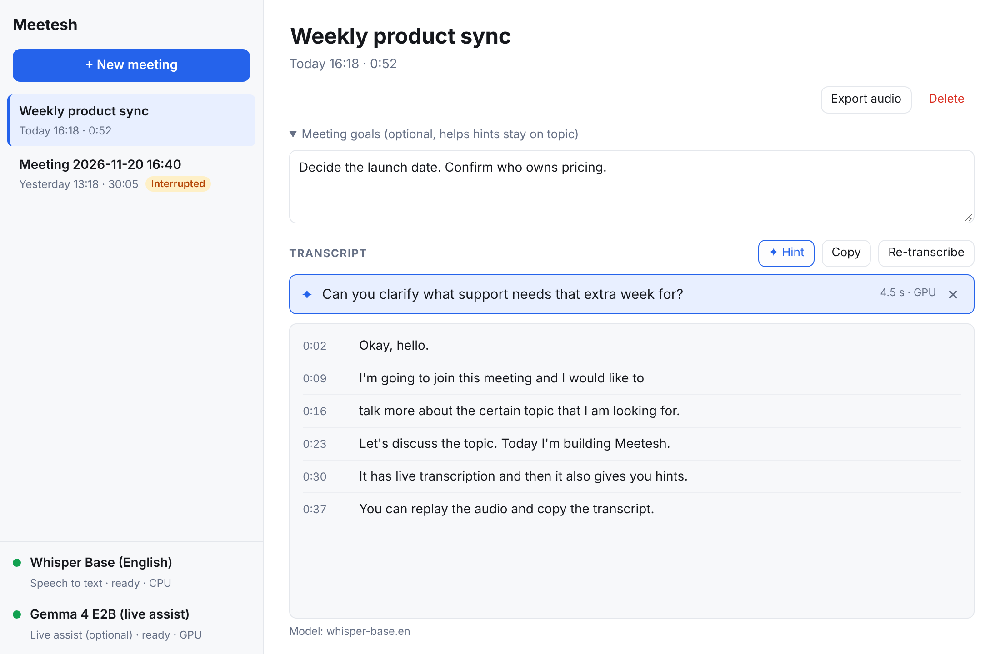
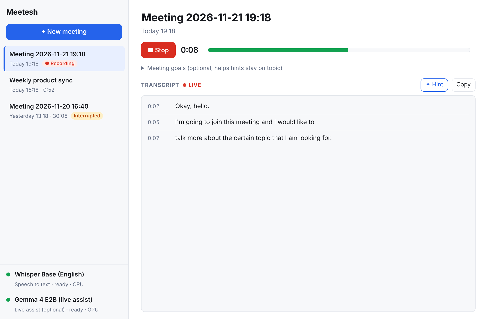
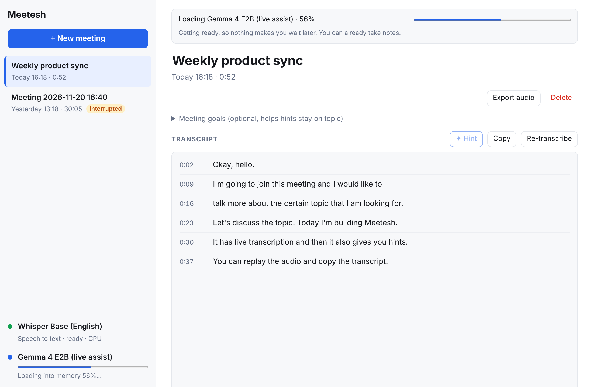
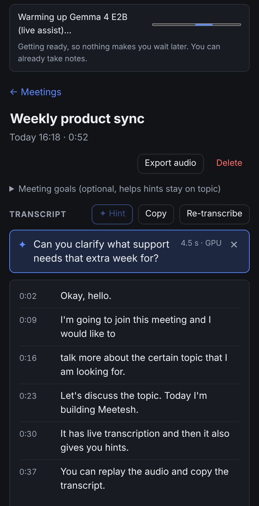

# Meetesh

**A private, local-first AI meeting assistant.** Record a meeting, get a live transcript, and ask for a quiet hint during the conversation. All on your own machine, with no account and no cloud.

[](https://github.com/nareshipme/Meetesh/actions/workflows/ci.yml)
[](LICENSE)

> **Status: early, pre-alpha.** Recording, live transcription and live assist work. The app has been opened and used by hand on macOS and Windows, and the maintainer found the generated hints good enough for a first version. CI builds and tests it on Linux, macOS and Windows. Expect rough edges (see [Known issues](#known-issues-and-planned-work)). Contributions and bug reports are very welcome.

The name comes from *ishara* (इशारा), Hindi/Urdu for a quiet hint or signal, like a glance across the table.

## Why Meetesh

- **Private by design.** Audio and transcripts stay on your device. After the one-time model download, the app works fully offline. Nothing is uploaded.
- **Local models.** Speech recognition ([whisper.cpp](https://github.com/ggml-org/whisper.cpp)) and live hints ([llama.cpp](https://github.com/ggml-org/llama.cpp) with Gemma 4 E2B) run on-device. No API keys needed.
- **Light and native.** Built with [Tauri](https://tauri.app) and Rust, not Electron.
- **Swappable models.** Models are listed in a manifest, not hard-coded, so improving or replacing one is a data change.
- **Open source (MIT).** Read it, fork it, improve it.

## Screenshots

These show the interface running against the built-in sample-data backend (see [CONTRIBUTING.md](CONTRIBUTING.md)), so the transcript text is sample text, not a real recording.


*A meeting with meeting goals, the transcript, and a hint streamed from the on-device model.*


*Recording: live text appears a few seconds behind speech.*


*Models load in the background at startup, with progress.*



*A narrow window in dark mode: one pane at a time.*

## What works today

| Feature | State |
|---|---|
| Record from the microphone, saved as crash-safe segments (about 1 s of audio at risk after a crash) | Working |
| Recover interrupted recordings on next launch | Working |
| Local transcription of a finished recording (Whisper) with timestamps | Working |
| Live transcription while recording (text a few seconds behind speech) | Working |
| Quiet or distant voices are no longer ignored: speech detection follows the room's noise level instead of a fixed volume, and each chunk is volume-normalized before Whisper hears it (on synthetic speech from a faint microphone: 62 of 62 words lost before, 0 lost now) | Working on synthetic speech; needs confirming on real recordings ([#4](https://github.com/nareshipme/Meetesh/issues/4)) |
| Model downloads you can pause, resume, retry or discard, with progress and a SHA-256 check (hashed while downloading, so there is no wait at 100%) | Working |
| Models load in the background at startup, with a progress bar (real percentage for the live-assist model) and a warm-up, so the first hint is not slow | Working |
| Live assist: ask for a short hint from the last few minutes (button or Ctrl/Cmd+Shift+H), written by an on-device model (Gemma 4 E2B), streamed into the window and labelled GPU or CPU | Working (manual trigger) |
| If the GPU cannot run the model, hints automatically fall back to the CPU, the sidebar says "CPU (GPU failed)", and llama.cpp's own error goes to the log | Working (a GPU failure is simulated in tests) |
| GPU for live assist: Metal on macOS, opt-in Vulkan on Windows and Linux (see [GPU acceleration](#gpu-acceleration)) | Metal compiles in CI but is failing on at least one Mac ([#3](https://github.com/nareshipme/Meetesh/issues/3)); Vulkan verified with a software Vulkan device only |
| `gpu_probe` tool that tries the known GPU workarounds and reports which one works | Working (Linux verified) |
| Hints never slow down live transcription: while the transcriber has work pending, hint generation pauses (in small steps, bounded so a hint is never starved). Measured with both real models on a 4-core CPU: live text arrived over 30 s late on average (up to 50 s) while hints ran before, and 2.6 s late now, about the same as with no hints (2.3 s) | Working |
| Optional meeting goals that keep hints on topic | Working |
| Meetings list, rename, delete (audio is deleted with the meeting), WAV export | Working |
| Responsive, dark-mode-aware UI | Working |

## Roadmap

| | Planned |
|---|---|
| Next | **Automatic hint triggers** (a question is asked, a long pause), a global hotkey, and a hint overlay that floats over other apps |
| Then | AI summaries (local via Ollama, or Claude with your own key), search, Markdown export |
| Then | System-audio capture so other participants are transcribed (per OS: WASAPI loopback, ScreenCaptureKit, PipeWire/PulseAudio) |
| Then | Settings and onboarding, signed installers and auto-update |
| Later | Mobile companion app, speaker labels, audio-file import |

## Known issues and planned work

Tracked as GitHub issues:

| Issue | Kind |
|---|---|
| [#3 GPU is not used for model inference](https://github.com/nareshipme/Meetesh/issues/3) (diagnostics, log capture and opt-in Vulkan added; the Mac cause still needs a `gpu_probe` run) | Bug |
| [#4 Missing words in the live transcript: improve audio before transcription](https://github.com/nareshipme/Meetesh/issues/4) (quiet-microphone loss fixed in tests; real-speech confirmation and a larger model option still open) | Improvement |
| [#6 One-click new recording](https://github.com/nareshipme/Meetesh/issues/6) | Improvement |
| [#7 Auto-generate the meeting title with the local model](https://github.com/nareshipme/Meetesh/issues/7) | Feature |
| [#8 Decide: should users be able to choose their models?](https://github.com/nareshipme/Meetesh/issues/8) | Design question |

## Limitations

- Hints are requested manually for now.
- The live-assist model is a 3.1 GB download and, once downloaded, is loaded into memory at every start (about 4 GB). A per-user switch to load it only on demand is planned.
- Models may run on the CPU even when a GPU is present ([#3](https://github.com/nareshipme/Meetesh/issues/3)). Speech recognition (Whisper) always runs on the CPU. On a CPU-only 4-core Linux machine a hint takes about 6 s.
- A hint can take longer to appear while people are talking, because it yields the processor to live transcription (a few seconds longer on a CPU-only machine; the transcript is never held up).
- Some words can still be missing or wrong in the live transcript ([#4](https://github.com/nareshipme/Meetesh/issues/4)). Faint voices used to be dropped entirely; that is fixed on synthetic test speech but not yet confirmed on real recordings. The default speech model (Whisper base) also simply mishears words, more so with accents and noise; a larger model is not offered yet.
- Microphone only. It cannot yet capture the other side of a call.
- English-only speech models are in the manifest for now.
- One recording per meeting.
- Whisper can mishear words, especially with noise or accents. The transcript is editable data, not ground truth.

## Troubleshooting

**The live-assist row says "CPU" or "CPU (GPU failed)", or a hint failed with "llama decode failed".** The GPU could not run the model (seen with Metal on macOS). Meetesh falls back to the CPU automatically, and llama.cpp's own error message is written to the log file, so nothing is lost. To find out which GPU setting works on your machine, run the probe. It tries the known workarounds, each in a fresh process, and prints which one works and the real error from the ones that fail:

```bash
cargo run -p meetesh-core --example gpu_probe --features metal      # macOS
cargo run -p meetesh-core --example gpu_probe --features vulkan     # Windows / Linux (needs the Vulkan SDK)
```
It looks for the model in the app's models folder; or pass the path as the last argument. Paste the whole output into [#3](https://github.com/nareshipme/Meetesh/issues/3), together with your Mac model, chip, macOS version and memory.

Other switches: `MEETESH_GPU=off` forces the CPU, and `MEETESH_LLAMA_LOGS=1` also writes llama.cpp's routine messages to the log (very chatty).

**Where is the log file?** In the app's log folder, usually `~/Library/Logs/app.meetesh.desktop/` on macOS, `%LOCALAPPDATA%\app.meetesh.desktop\logs` on Windows and `~/.local/share/app.meetesh.desktop/logs` on Linux. The sidebar shows the exact folder when the GPU failed. Logs never contain transcript or audio content.

**A model download is stuck or failed.** Use Pause, Resume, Retry or Discard in the model panel. A paused or failed download keeps what it already has, so Resume continues from there.

**A model fails to load ("Could not load").** Press Retry in the model panel. If it keeps failing, there may not be enough free memory (the assist model needs about 4 GB).

**Where is my data?** The database, recordings and models live in the app data folder (see [TESTING.md](TESTING.md)). Deleting a meeting deletes its audio.

## Quick start

You need Rust, Node 20+, a C/C++ toolchain with `cmake` and clang (Whisper compiles from source on the first build), and the [Tauri prerequisites](https://tauri.app/start/prerequisites/) for your OS.

```bash
git clone https://github.com/nareshipme/Meetesh.git
cd Meetesh
npm install
npm run tauri dev
```

The first build takes several minutes: Whisper and llama.cpp compile from source, and dependencies are built optimized even in dev builds (so hashing a 3 GB model is fast). Then in the app:
1. Download the speech model from the sidebar (about 148 MB, once). The optional live-assist model is 3.1 GB. Downloaded models load in the background at every start; the bar at the top shows progress.
2. Create a meeting and click **Record**. Your OS may ask for microphone permission.
3. Talk. Live text appears as you speak. Click **Stop** when done.

See [TESTING.md](TESTING.md) for a full manual test checklist.

## GPU acceleration

Only the live-assist model (llama.cpp) can use the GPU. Speech recognition runs on the CPU on every platform.

| Platform | How |
|---|---|
| macOS | Metal is compiled in automatically. If it fails on your Mac the app falls back to the CPU (see Troubleshooting). |
| Windows, Linux | Opt-in Vulkan (works with NVIDIA, AMD and Intel GPUs). Install the Vulkan SDK first (Windows: LunarG SDK; Ubuntu: `sudo apt install libvulkan-dev glslc spirv-headers`), then run `npm run tauri dev -- --features vulkan`. |

The Vulkan build has been verified to compile, load the model onto a Vulkan device and generate with it on Linux using a software Vulkan driver (so the speed on a real GPU is not yet measured). CUDA is not wired up yet.

## How it works

```
mic (cpal) ─> resample to 16 kHz mono ─┬─> segmented WAV on disk   (crash-safe)
                                       ├─> level meter
                                       └─> VAD chunker ─> bounded queue ─> Whisper worker ─> transcript (SQLite) ─> UI
```

- The audio callback never blocks. Slow transcription drops live chunks (counted) instead of slowing capture, and a full pass over the saved audio fills any gaps after you stop.
- Everything that does not depend on the operating system lives in a platform-neutral Rust crate, so other front ends (and later a mobile app) can reuse it.

```
crates/meetesh-core/   platform-neutral core: storage, audio pipeline, ASR, model manager (no desktop-only deps)
src-tauri/             desktop shell: microphone capture and thin Tauri commands over the core (commands/, state, live, events)
src/                   React + TypeScript UI: components/, hooks/, lib/ (all backend calls go through src/api.ts)
prototype-web/         the original Python/browser prototype, kept for reference
```

Models are described in [`crates/meetesh-core/manifest.json`](crates/meetesh-core/manifest.json): id, URL, SHA-256, size, license and per-device defaults.

## Development

```bash
cargo test --workspace      # unit and end-to-end tests, no hardware or models needed
```

Tests that run a real speech model are opt-in:

```bash
MEETESH_TEST_MODEL=/path/to/ggml-tiny.en.bin \
  cargo test -p meetesh-core --features whisper --test whisper_fixture --test whisper_live -- --nocapture
```

```bash
npm run tauri build         # installers for the OS you build on
```

### Transcription quality bench

Changes to voice detection, chunking or volume handling must be measured, not guessed. `tests/asr_quality.rs` plays known sentences (synthetic speech, see `tests/fixtures/speech/README.md`) through the pipeline in different conditions (clean, quiet, noisy, no pauses, trailing off, hum, faint far-away microphone) and reports the word error rate and how many words went missing, for the live path and for the whole recording:

```bash
MEETESH_TEST_MODEL=/path/to/ggml-base.en.bin \
  cargo test -p meetesh-core --features whisper --test asr_quality -- --nocapture
# one change at a time (old behaviour, each feature alone, everything):
MEETESH_ABLATION=1 MEETESH_TEST_MODEL=... cargo test -p meetesh-core --features whisper --test asr_quality ablation -- --nocapture
```

The speech is synthetic, so it checks the audio handling and says nothing about Whisper's accuracy on real voices. Numbers vary by a few words between runs of different settings, so compare more than one model before trusting a small difference.

### Hints versus live transcription

`tests/hint_vs_live.rs` plays speech through live transcription in real time while hints are generated back to back, and reports how late each transcript segment arrives (no hints, hints that ignore transcription, hints that yield). It needs both models:

```bash
MEETESH_TEST_MODEL=/path/to/ggml-base.en.bin MEETESH_TEST_ASSIST_MODEL=/path/to/gemma-4-E2B-it-Q4_K_M.gguf \
  cargo test -p meetesh-core --features "whisper llm" --test hint_vs_live -- --nocapture
```

## Contributing

Issues, ideas and pull requests are welcome. Read [CONTRIBUTING.md](CONTRIBUTING.md) first. Good places to start: testing on Windows or macOS, accuracy and latency reports with different microphones, and anything under "Roadmap".

## Privacy and recording consent

Meetesh does not send audio or transcripts anywhere. The only network access is downloading models you ask for (and, once added, an optional summary provider you choose). The app shows a consent reminder before each recording, but **you are responsible for following the recording laws and meeting etiquette that apply to you**. Many places require everyone's consent.

## License

[MIT](LICENSE) © Meetesh contributors.

Speech recognition uses [whisper.cpp](https://github.com/ggml-org/whisper.cpp) (MIT) and OpenAI Whisper model weights (MIT). Live assist uses [llama.cpp](https://github.com/ggml-org/llama.cpp) (MIT) and Google's Gemma 4 E2B (Apache-2.0, GGUF conversion by Unsloth). Models are downloaded on demand. Built with [Tauri](https://tauri.app), [cpal](https://github.com/RustAudio/cpal) and [rusqlite](https://github.com/rusqlite/rusqlite). Inspired by Meetily, the open-source meeting assistant.
